<p align="center">
  <picture>
    <source media="(max-width: 600px) and (prefers-color-scheme: light)" srcset=".github/assets/banner-phone-light.svg">
    <source media="(max-width: 600px)" srcset=".github/assets/banner-phone.svg">
    <source media="(prefers-color-scheme: light)" srcset=".github/assets/banner-light.svg">
    
  </picture>
</p>

<div align="center">

[](https://github.com/yungSNAT/ShaphansAudit/actions/workflows/ci.yml?query=branch%3Amain) [](#licence)

[Install](#install) · [Use](#use) · [Privacy](#privacy) · [Limits](#limits) · [Development](#development) · [Credits](#credits) · [Licence](#licence)

</div>

`shaphan` reads the transcripts that Claude Code and Codex save on your machine and reports where tokens and checks are wasted: context loaded before the first reply, tool schemas loaded but never called, test output piped past its exit status, repeated polling, files re-read after a compaction and slow hooks.

It prints names, paths, counts, sizes and times, as listed under [Privacy](#privacy). It never prints message text, tool inputs or tool outputs, and it makes no network calls.

## Install

There is no prebuilt download yet. With Rust 1.99 or later installed, this builds and installs `shaphan`:

```bash
cargo install --locked --git https://github.com/yungSNAT/ShaphansAudit
```

To build from a clone instead, with the compiler pinned in `rust-toolchain.toml` (rustup installs it if needed):

```bash
git clone https://github.com/yungSNAT/ShaphansAudit
cd ShaphansAudit
cargo install --locked --path .
```

## Use

```bash
shaphan all
```

This reads the last 7 days of `~/.claude/projects`, `~/.codex/sessions` and `~/.codex/archived_sessions` and prints one section per detector. Run one detector by name, for example `shaphan hooks --since 24h`.

From a clone, this runs it on the synthetic test transcripts:

```bash
shaphan all --since 2026-11-01 --claude-root tests/fixtures/claude --codex-root tests/fixtures/codex
```

Part of its output on a machine without `rtk`, with the `startup`, `schemas`, `polls` and `rereads` sections left out (hook labels name only programs found on your machine):

```text
shaphan 0.1.0: records since 2026-11-01 00:00 +11:00
claude: 3 files under tests/fixtures/claude (unreadable files or folders: 0, lines skipped: 1, compressed files skipped: 0)
codex: 2 files under tests/fixtures/codex (unreadable files or folders: 0, lines skipped: 0, compressed files skipped: 0)

== pipes: test runs piped into tail or head (Claude Bash, Codex commands) ==
test runs: 5
piped into tail or head: 5
over ssh not judged: 1
guarded with pipefail or pipestatus: 1
unguarded: 3
unguarded results found: 2
unguarded reported success: 2
showed a failure but reported success: 1
showed no pass or fail line: 0
codex outputs not paired: 0

By agent
  agent   test runs  piped into tail or head  over ssh not judged  guarded with pipefail or pipestatus  unguarded  unguarded results found  unguarded reported success  showed a failure but reported success  showed no pass or fail line
  claude          5                        5                    1                                    1          3                        2                           2                                      1                            0
Note: An unguarded pipe reports tail's or head's exit status, not the test runner's.
Note: Fix: set -o pipefail before the pipe, or keep the runner's own exit status.
Note: A Codex result counts only when its exec cell printed one exec_command result per command; Codex outputs not paired counts the cells with an unguarded test run whose results could not be paired: the cell had no call id, its output never came or it did not print one result per command. Codex may run PowerShell, where pipefail does not apply; a failure shown whilst the exit code was 0 is hidden there too.

== hooks: hook runs, cancellations and durations (Claude) ==

By hook name and command, most cancellations first
  hook name             hook           runs  cancelled  timed out  errors  median ms  p90 ms  max ms  median output chars
  PreToolUse:Bash       (other)           1          1          1       0      15000   15000   15000                    -
  SessionStart:startup  hub-digest.js     1          0          0       0        120     120     120                   19
  PreToolUse:Bash       guard.exe         1          0          0       0         40      40      40                    0
```

| Command | Agents | Reports |
|---|---|---|
| `startup` | Claude | Characters loaded before the first reply of each main session, by source: instruction files, hook output, listings, tool schemas and MCP instructions; also the input tokens recorded for that first reply |
| `schemas` | Claude | Per tool or MCP server: sessions that loaded its schema, sessions that called it, and the characters loaded in sessions that never called it |
| `pipes` | Claude, Codex | Test runs piped into `tail` or `head` without `pipefail` or `PIPESTATUS`, and how many printed a failure whilst the call reported success, in total and by agent |
| `polls` | Claude, Codex | Commands repeated exactly within a session, split into polls (no file edit since the last run) and reruns after an edit, the polls of a command whose last result was an error and the characters polls returned |
| `rereads` | Claude, Codex | Files read again after a context compaction that had been read before it, and the characters those re-reads returned |
| `hooks` | Claude | Hook runs, cancellations, timeouts and durations, by event, matcher and hook |

| Option | Default | Meaning |
|---|---|---|
| `--since` | `7d` | Start of the window: `Nd`, `Nh`, a date (local midnight) or an RFC 3339 time |
| `--agent` | `all` | `claude`, `codex` or `all` |
| `--claude-root DIR` | `~/.claude/projects` | Claude Code transcript folder |
| `--codex-root DIR` | `~/.codex/sessions` and `~/.codex/archived_sessions` | Codex transcript folder; a given folder replaces both |
| `--json` | off | Print one JSON object with `schema_version` 1 |
| `--limit N` | 20 | Rows per table |
| `--paths` | off | List the most re-read file paths |

Columns ending in `tokens est` (`_tokens_est` in JSON) estimate tokens as the characters beside them divided by 4, rounded up in each row, so rows need not add up to a total.

Exit codes: 0 success, 1 a runtime error such as a missing transcript folder or a bad `--since`, 2 a usage error.

## Privacy

Output holds tool and MCP server names, instruction file paths, hook names and labels, attachment types, entry points, command verb classes, the scanned folders, counts, sizes and times. Paths under your home folder start with `~`. Re-read file paths appear only with `--paths`. A verb class or hook label prints only the name of a program found on your machine (a common command, a common PowerShell cmdlet, a program on `PATH` or an existing script); anything else prints as `(other)`, so labels can differ between machines. A script written as a network share path, such as `\\host\share\run.ps1`, is never looked up on disk, because the lookup would contact that host; only its file name is checked. A path your system maps to a network location, such as a drive letter mapped to a share or an automounted folder, is looked up like a local path. Read the output before you share it.

The tests run on synthetic fixtures. They plant sentinel strings in message text, tool inputs, tool outputs and hook commands, and in a probe of each way found so far that input text could reach a verb class, hook label or path, then check that none reaches the output in any letter case.

## Limits

Both transcript formats are undocumented and change between releases. `shaphan` skips a line it cannot parse and reports how many it skipped. It reads compressed Codex transcripts (`*.jsonl.zst`) as it goes. One that does not start with the zstd magic number counts as a compressed file skipped; one whose frame header cannot be read, that fails part way, has a bad checksum or holds more than one zstd frame counts as unreadable, and the records read before the failure still count. It reads Codex transcripts for `pipes`, `polls` and `rereads` only. A Codex call runs code that can start several commands, so their results count only when the call printed one result per command. [docs/DESIGN.md](docs/DESIGN.md) defines each measure.

For usage and cost totals, use [ccusage](https://github.com/ccusage/ccusage). [CodeBurn](https://github.com/getagentseal/codeburn) 0.9.28 `optimize`, [caveman](https://github.com/JuliusBrussee/caveman) 4.1.0 `learn` and [Claude Code](https://github.com/anthropics/claude-code) 2.1.323 `/usage` report priced setup waste. According to their documentation as read on 13 November 2026 ([optimize](https://github.com/getagentseal/codeburn/blob/main/docs/optimize.md), [learn](https://github.com/JuliusBrussee/caveman/blob/main/docs/technical/learn.md), [costs](https://code.claude.com/docs/en/costs)), none reports test failures hidden by a pipe, hook durations and cancellations, or polls split from reruns after an edit.

## Development

`rust-toolchain.toml` pins the compiler. CI runs these on Linux and Windows:

```bash
cargo fmt --check
cargo clippy --locked --all-targets -- -D warnings
cargo test --locked
```

## Credits

Named after Shaphan, the scribe who counted the temple silver and read the recovered scroll to the king (2 Kings 22, [NET](https://netbible.org)).

The banner's lettering uses Cascadia Mono and Besley glyphs (SIL OFL 1.1); its coin emblem is hand-drawn pixel art.

## Licence

Licensed under the Functional Source License, Version 1.1, ALv2 Future License (FSL-1.1-ALv2). You may use, modify and redistribute it for any purpose except a Competing Use as defined in [LICENSE](LICENSE), and each version becomes available under Apache-2.0 2 years after it is made available.

---

<p align="center"><sub>(John 6:12, <a href="https://netbible.org">NET</a>)<br>Made by <a href="https://github.com/yungSNAT">yungSNAT</a>. <i>Ad gloriam eius, non meam.</i></sub></p>
